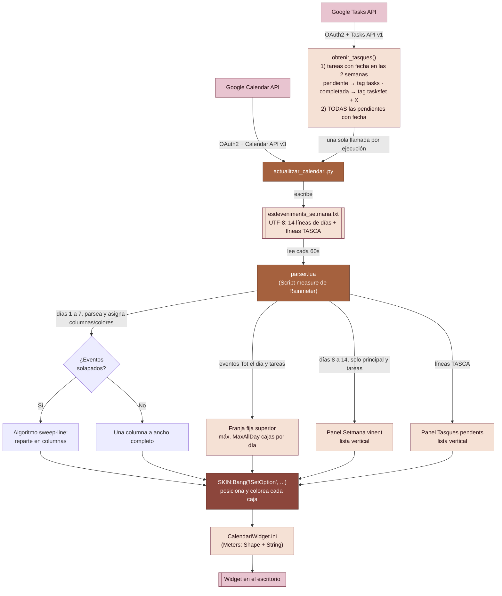
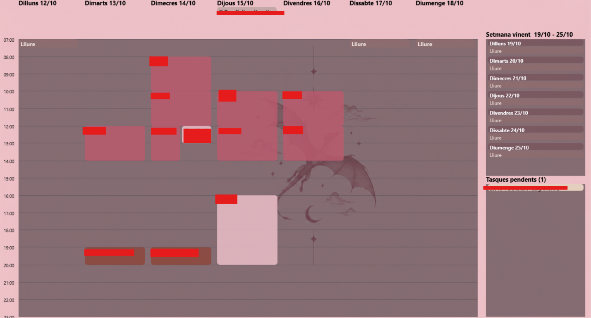

# Calendario — Rainmeter Widget

Un widget de escritorio para **Rainmeter** que muestra tu semana de Google Calendar (y tus tareas de Google Tasks) en formato horizontal (estilo "vista semanal" de Google Calendar), con eventos repartidos automáticamente en columnas cuando se solapan, y una paleta de colores personalizada por calendario. A la derecha de la rejilla añade dos paneles verticales: la **semana siguiente** (solo calendario principal y tareas) y **todas tus tareas pendientes**, de cualquier fecha.

El proyecto tiene dos partes que trabajan juntas:

1. **`actualitzar_calendari.py`** — script en Python que se conecta a la Google Calendar API y a la Google Tasks API, descarga los eventos y tareas de la semana actual y la siguiente (de todos tus calendarios y listas de tareas), además de todas las tareas pendientes con fecha, y los vuelca a un fichero de texto plano.
2. **Skin de Rainmeter** (`CalendariWidget.ini` + `parser.lua`) — lee ese fichero de texto y dibuja la rejilla semanal y los dos paneles de la derecha en el escritorio, calculando el layout y asignando colores según el calendario de origen de cada evento.

---

## Características

- Vista semanal horizontal (Lunes → Domingo), franja horaria de 07:00 a 23:00.
- Reparto automático de eventos solapados en columnas, igual que hace Google Calendar en su vista de semana/día (algoritmo *sweep-line*).
- Franja fija superior para eventos de "Todo el día" (hasta 4 por día, compartidos con las tareas) y hasta 8 eventos con hora por día.
- **Tareas de Google Tasks** con fecha límite: aparecen en la franja de "Todo el día" del día que vencen. Las completadas se muestran en gris apagado y con el prefijo "X".
- **Panel "Setmana vinent"** (a la derecha): los 7 días de la semana siguiente en una lista vertical, con una cabecera por día. Solo muestra los eventos del calendario principal y las tareas. Los días sin nada ponen "Lliure".
- **Panel "Tasques pendents"** (debajo del anterior): todas las tareas **no completadas** que tienen fecha límite, de cualquier fecha (también las atrasadas), ordenadas por fecha y con su día delante.
- Si una lista no cabe en la altura de su panel, la última fila indica cuántas quedan fuera (`... +N més`).
- Colores por calendario, en una paleta de rosas y marrones, con transparencia; el color del texto (blanco/negro) se elige automáticamente según el contraste de cada fondo.
- Soporte para eventos que cruzan la medianoche (se parten en dos bloques, uno por día).
- Lectura robusta de codificación (UTF-8 y UTF-16 con BOM).
- Actualización automática cada 60 segundos por parte del skin (lectura del fichero de texto); la descarga de Google Calendar y Google Tasks se ejecuta por separado (manual o programada).

## Arquitectura



### Flujo resumido

1. **Autenticación** — `actualitzar_calendari.py` usa OAuth2 (`credentials.json` → `token.json`) para autenticarse contra Google con permisos de solo lectura. Los permisos (*scopes*) son tres: `calendar.readonly`, `calendar.calendarlist.readonly` y `tasks.readonly`.
2. **Descarga de eventos** — obtiene la lista de calendarios del usuario, y para cada uno, los eventos de **dos semanas**: la actual y la siguiente (14 días, de lunes a domingo).
3. **Descarga de tareas** — Google Tasks **no forma parte de la Calendar API**: tiene su propia API, así que `obtenir_tasques()` lee por separado todas las listas de tareas. Por cada lista hace dos consultas: (a) las tareas con fecha límite dentro de las dos semanas, pendientes y completadas, que se pintan en su día; y (b) **todas las pendientes** con fecha límite, de cualquier fecha, para el panel "Tasques pendents". Se llama **una sola vez por ejecución**, fuera del bucle de calendarios.
4. **Clasificación por tag** — el nombre de cada calendario se compara contra `DICCIONARI_TAGS` para asignarle una etiqueta (`principal`, `horari`, `treball`, `gym`, `aniversaris`, `tasks`); si no coincide con ninguna palabra clave, se usa `principal` por defecto. Las tareas de Google Tasks no pasan por el diccionario: las pendientes llevan siempre el tag `tasks` y las completadas `tasksfet`. Para la semana siguiente solo se conservan los tags de `TAGS_SETMANA_VINENT` (`principal`, `tasks` y `tasksfet`).
5. **Serialización** — escribe `esdeveniments_setmana.txt`, un fichero UTF-8 con 14 líneas de días (formato `NombreDia|evento1 # evento2 # ...`) seguidas de una línea `TASCA|...` por cada tarea pendiente (ver [formato del fichero](#formato-de-esdeveniments_setmanatxt)). Las tareas con fecha se escriben como eventos de "Tot el dia" (`Tot el dia - Título [tasks]`), porque Google Tasks solo guarda la fecha, no la hora. Antes de escribir, los títulos se limpian: se colapsan los saltos de línea y la `#` (separador del fichero) se sustituye por `＃`.
6. **Lectura por Rainmeter** — `parser.lua` (medida `Script` dentro de `CalendariWidget.ini`) relee ese fichero en cada ciclo de `Update`.
7. **Layout** — para los 7 primeros días, separa eventos de "todo el día" y tareas (franja fija arriba) de eventos con hora; a estos últimos les aplica el algoritmo de columnas para que los solapados se repartan en paralelo, igual que en Google Calendar. Los días 8 a 14 se convierten en una lista vertical (cabecera de día + eventos/tareas) para el panel "Setmana vinent", y las líneas `TASCA` en otra lista para "Tasques pendents".
8. **Render** — por cada evento, `parser.lua` llama a `SKIN:Bang('!SetOption', ...)` para mover, redimensionar, colorear y mostrar el par de *meters* `MeterEventBg_D_S` (fondo) y `MeterEvent_D_S` (texto) correspondientes a ese día (`D`) y slot (`S`). Los paneles de la derecha usan sus propios pares de meters por fila: `MeterPropBg_N` / `MeterProp_N` ("Setmana vinent") y `MeterTascaBg_N` / `MeterTasca_N` ("Tasques pendents").

### Formato de `esdeveniments_setmana.txt`

El fichero tiene tres bloques, siempre en este orden:

```
Dilluns 12/10|Lliure (Sense esdeveniments)
Dimarts 13/10|12:00-14:00 - TMIRI [horari] # 19:00-20:00 - Piernas + triceps [gym]
Dijous 15/10|Tot el dia - X Parallelism iteration 1 [tasksfet] # 10:00-12:00 - SMDE [horari]
...                                   (hasta el domingo de la semana actual: 7 líneas)
Dilluns 19/10|Lliure (Sense esdeveniments)
Dimarts 20/10|Tot el dia - Entregar informe [tasks]
...                                   (hasta el domingo de la semana siguiente: 7 líneas más)
TASCA|30/10|Entregar informe
TASCA|15/01/27|Renovar carnet
```

- **Líneas 1 a 7:** la semana actual, con los eventos de **todos** los calendarios.
- **Líneas 8 a 14:** la semana siguiente, solo con los tags `principal`, `tasks` y `tasksfet`.
- **Líneas `TASCA|fecha|título`:** todas las tareas pendientes con fecha límite, ordenadas por fecha (las atrasadas primero). La fecha es `dd/mm`, y `dd/mm/aa` cuando el año no es el actual.

Si el fichero es de una versión anterior (solo 7 líneas), el panel "Setmana vinent" muestra "Sense dades (executa el script)" hasta que vuelvas a ejecutar el script.

---

## Estructura del repositorio

```
CalendariHoritzontal/
├── actualitzar_calendari.py     # Script Python: Google Calendar + Google Tasks -> fichero de texto
├── debug_tasques.py             # (opcional) diagnóstico: lista todas las tareas tal como las devuelve Google
├── credentials.json             # (NO subir a git) credenciales OAuth de Google Cloud
├── token.json                   # (NO subir a git, se genera solo) token de sesión
├── esdeveniments_setmana.txt    # (generado) datos de las dos semanas y tareas, leídos por el widget
└── @Resources/
    ├── CalendariWidget.ini      # Definición del skin de Rainmeter (meters)
    └── parser.lua               # Motor de parseig + layout + colores
```

> **Importante:** `credentials.json` y `token.json` contienen datos sensibles de tu cuenta de Google. Añádelos a `.gitignore` y no los subas nunca al repositorio.

---

## Paleta de colores por calendario

Definida en `parser.lua`, tabla `Colors` / `TextColors`. Todos los fondos llevan un punto de transparencia (canal alfa ≈ 84%) para integrarse con el fondo del escritorio; la excepción es `tasksfet`, más transparente a propósito para que parezca apagado.

| Tag (`DICCIONARI_TAGS`) | Calendario de ejemplo | Color de fondo (RGBA) | Color de texto |
|---|---|---|---|
| `principal` | Calendario principal / personal | `235,190,200,215` — rosa pastel | Negro |
| `horari` | Horario / clases | `185,90,110,215` — rosa vino | Blanco |
| `treball` | Trabajo / beca | `165,95,75,215` — terracota | Blanco |
| `gym` | Gimnasio | `140,70,60,215` — marrón rojizo | Blanco |
| `aniversaris` | Cumpleaños | `90,55,50,215` — marrón chocolate | Blanco |
| `tasks` | Tareas pendientes (Google Tasks) | `245,225,205,215` — beige/crema | Negro |
| `tasksfet` | Tareas completadas (Google Tasks) | `170,150,145,150` — gris rosado apagado | `70,60,60,255` — gris oscuro |
| *(desconocido)* | Cualquier otro | `120,95,95,190` (`ColorDefaultBg`) | Blanco (`ColorDefaultText`) |
| *(día libre)* | Sin eventos | `150,110,110,140` (`ColorBuit`) | Blanco roto (`ColorBuitText`) |
| *(cabecera de día)* | Cabecera de cada día en "Setmana vinent" | `120,85,95,215` (`ColorCapcalera`) | Blanco (`ColorCapceleraText`) |
| *(fondo de paneles)* | Fondo de los dos paneles de la derecha | `15,15,20,120` (`ColorPanell`) | — |

La regla de contraste es simple: si la luminosidad del fondo es alta (color claro), el texto va en negro; si es baja (color oscuro), el texto va en blanco. Para añadir o cambiar un color, edita ambas tablas (`Colors` y `TextColors`) a la vez para mantener la legibilidad.

> **Nombres de tag:** el parser solo reconoce tags formados por **letras** (patrón `%a+`). Un tag con guion bajo o números (por ejemplo `tasks_fet`) haría que esa línea se descartara en silencio. Por eso el tag de las completadas es `tasksfet`.

---

## Requisitos

- **Rainmeter** ≥ 4.3 (necesita soporte de *Script measures* con Lua y de *Shape meters*).
- **Python** 3.9+ para el script de sincronización.
- Dependencias de Python:
  ```bash
  pip install google-auth google-auth-oauthlib google-api-python-client
  ```
  Si tienes varios Pythons instalados, instálalas en el **mismo** que usarás para ejecutar el script: `python -m pip install ...` (o `py -m pip install ...` en Windows) garantiza que se instalen en el intérprete correcto.
- Un proyecto en **Google Cloud Console** con la **Google Calendar API** y la **Google Tasks API** habilitadas, y credenciales OAuth de tipo *Desktop App* descargadas como `credentials.json`.
- Espacio en pantalla: con los valores por defecto el widget ocupa unos **1410 × 770 px** (la rejilla semanal más la columna de paneles de la derecha).

Ambas APIs son gratuitas y no requieren activar facturación; el uso de este widget (unas pocas decenas de peticiones por ejecución) queda muy lejos de las cuotas diarias.

---

## Instalación

1. **Clona o copia** este repositorio dentro de tu carpeta de skins de Rainmeter, normalmente:
   ```
   %USERPROFILE%\Documents\Rainmeter\Skins\CalendariHoritzontal\
   ```
2. **Configura Google Cloud:**
   - Crea un proyecto en [Google Cloud Console](https://console.cloud.google.com/).
   - Habilita la **Google Calendar API** y la **Google Tasks API** (*APIs y servicios → Biblioteca*).
   - Crea credenciales OAuth 2.0 de tipo "Aplicación de escritorio" y descarga el JSON como `credentials.json` en la raíz del proyecto.
3. **Instala las dependencias de Python** (ver sección de Requisitos).
4. **Ejecuta el script una vez** para autenticarte, **desde la carpeta del script** (el script busca `token.json` y `credentials.json` en la carpeta desde la que lo lanzas):
   ```bash
   cd %USERPROFILE%\Documents\Rainmeter\Skins\CalendariHoritzontal
   python actualitzar_calendari.py
   ```
   Se abrirá el navegador para el login de Google; tras aceptar los permisos (calendario y tareas), se generará `token.json` (las siguientes ejecuciones ya no pedirán login, hasta que el token caduque).
   > Si ya tenías un `token.json` de una versión anterior sin soporte de tareas, **bórralo** antes de ejecutar: guarda los permisos antiguos y nunca pediría el permiso de Tasks.
5. **Verifica** que se ha creado `esdeveniments_setmana.txt` en la misma carpeta.
6. **Carga el skin en Rainmeter:** clic derecho en el icono de Rainmeter en la bandeja del sistema → *Manage* → busca `CalendariHoritzontal` → *Load*.
7. **(Opcional) Automatiza la sincronización** para que el widget se mantenga al día sin ejecutarlo a mano — por ejemplo con el Programador de tareas de Windows:
   ```
   Programador de tareas → Crear tarea básica
   Desencadenador: cada 30-60 minutos
   Acción: python.exe  C:\ruta\a\actualitzar_calendari.py
   Iniciar en: C:\ruta\a\   (la carpeta del script; si lo dejas vacío no encontrará token.json)
   ```
   Usa el `python.exe` que tenga instaladas las librerías de Google.

---

## Personalización

### Cambiar qué calendarios llevan qué tag

Edita `DICCIONARI_TAGS` en `actualitzar_calendari.py`. La clave es una palabra que se busca (en minúsculas) dentro del **nombre** del calendario en Google Calendar; el valor es el tag que se escribirá en el fichero de texto y que `parser.lua` usará para elegir el color:

```python
DICCIONARI_TAGS = {
    'principal':   'principal',
    'horari':      'horari',
    'treball':     'treball',
    'beca':        'treball',   # varios nombres de calendario -> mismo tag
    'gym':         'gym',
    'aniversaris': 'aniversaris',
    'tasks':       'tasks',
}
```

> Las tareas de **Google Tasks** no dependen de este diccionario: se leen por su propia API y usan siempre los tags `tasks` (pendiente) y `tasksfet` (completada).

### Cambiar qué se ve en "Setmana vinent"

Edita `TAGS_SETMANA_VINENT` en `actualitzar_calendari.py`. Por defecto solo contiene `principal`, `tasks` y `tasksfet`; si añades, por ejemplo, `'treball'`, los eventos de ese calendario también saldrán en el panel de la semana siguiente.

### Cambiar la paleta de colores

Edita las tablas `Colors` y `TextColors` en `parser.lua`. Después de guardar, **haz un Refresh del skin en Rainmeter** (los scripts Lua no se recargan solos, ver sección de Troubleshooting).

### Cambiar horario visible, tamaño de columnas, etc.

Las constantes al inicio de `parser.lua` controlan el layout:

| Variable | Significado |
|---|---|
| `NumDies` | Número de columnas/días mostrados (7) |
| `MaxAllDay` | Franjas reservadas para eventos "todo el día" **y tareas** por columna (por defecto 4) |
| `MaxTimed` | Franjas reservadas para eventos con hora por columna (por defecto 8) |
| `AmpladaColumna` / `EspaiColumnes` | Ancho de cada columna de día y espacio entre ellas |
| `TimeStart` / `TimeEnd` | Rango horario visible (en minutos desde medianoche) |
| `PxPerMin` | Píxeles verticales por minuto (controla la "altura" de la rejilla) |

Dos cosas a tener en cuenta al tocar `MaxAllDay` / `MaxTimed`:

- **Meters por día:** `MaxEvents = MaxAllDay + MaxTimed` es el número de pares de meters (`MeterEventBg_D_S` / `MeterEvent_D_S`) que `CalendariWidget.ini` define por cada día (12 por defecto). Mientras la suma no supere los meters existentes, no hace falta tocar el `.ini`; si la superas, hay que añadir más meters por día (copia el último par y cambia el número). Los eventos que no caben en su franja no se muestran, y el parser no avisa: se pierden los últimos del día por orden de hora.
- **Posición de la rejilla:** el inicio de la rejilla horaria se calcula como `YGrid = YAllDayStart + MaxAllDay × AltAllDay + 6` (con los valores por defecto, `20 + 4 × 18 + 6 = 98`). El `.ini` tiene la rejilla escrita con coordenadas fijas (`FonsGraella`, las etiquetas `MeterHoraN` y las líneas `LiniaHoraN`), así que si cambias `MaxAllDay` debes desplazar esos elementos la misma cantidad de píxeles (18 px por cada franja de más o de menos).

### Cambiar los paneles de la derecha

Los dos paneles se colocan a la derecha de la rejilla y su posición sale de estas constantes de `parser.lua` (el `.ini` solo trae valores iniciales equivalentes: `parser.lua` recoloca fondos y títulos en cada actualización):

| Variable | Significado |
|---|---|
| `AmpladaPanell` | Ancho de los paneles (240) |
| `XPropera` / `XTasques` | Posición horizontal de cada panel. Por defecto son iguales: los dos paneles comparten columna, a 20 px de la rejilla |
| `SeparacioPanells` | Espacio vertical entre los dos paneles (10) |
| `AltPropera` | Altura del panel "Setmana vinent" (la mitad de la altura de la rejilla menos la separación) |
| `YTasques` / `AltTasques` | Posición y altura del panel "Tasques pendents". Incluyen 10 px extra para dejar sitio a su título |
| `AltFila` / `EspaiDia` | Alto de cada fila (18) y espacio extra antes de la cabecera de cada día (6) |
| `PoolFiles` | Filas (pares de meters) que el `.ini` define por panel (37). Si cambias `AltFila` a un valor más pequeño y caben más filas, hay que añadir meters `MeterProp_N` / `MeterTasca_N` |

Con los valores por defecto caben unas 17 filas en cada panel (en "Setmana vinent" cuentan también las cabeceras de día). Si no cabe todo, la última fila se usa para resumir lo que queda fuera (`... +N més`).

---

## Troubleshooting

- **He cambiado `parser.lua` o el `.ini` y no se nota nada:** los scripts Lua no se recargan solos. Haz clic derecho sobre el skin → *Refresh skin*.
- **`ModuleNotFoundError: No module named 'google'`:** el Python con el que ejecutas el script no tiene las librerías de Google. Cada instalación de Python (Microsoft Store, Miniconda, MSYS2...) tiene sus propios paquetes. Instálalas en el intérprete que uses (`python -m pip install google-auth google-auth-oauthlib google-api-python-client`) y, en VS Code, selecciona ese mismo intérprete (*Python: Select Interpreter*). Evita el Python de MSYS2, que suele bloquear `pip`.
- **`FileNotFoundError: ... 'credentials.json'` (o no encuentra `token.json`):** el script busca esos ficheros en la carpeta **desde la que lo ejecutas**, no donde está guardado el `.py`. Ejecútalo desde la carpeta del script (en VS Code, abre esa carpeta con *Archivo → Abrir carpeta*; en el Programador de tareas, rellena *Iniciar en*).
- **`invalid_grant: Token has been expired or revoked`:** el permiso guardado en `token.json` ya no es válido (caducidad, revocación o token de otra copia del script). Borra `token.json`, ejecuta el script y autoriza de nuevo en el navegador. Si se repite cada semana, mira la entrada sobre el modo *Testing* más abajo.
- **Las tareas no aparecen:**
  - Solo se muestran las tareas **con fecha límite**; sin fecha no hay día donde ponerlas ni orden en la lista de pendientes.
  - En la rejilla y en "Setmana vinent" solo salen las de la semana actual y la siguiente. El panel "Tasques pendents" muestra todas las pendientes con fecha, de cualquier fecha.
  - Comprueba que la **Google Tasks API** está habilitada en tu proyecto y que has borrado el `token.json` antiguo tras añadir el permiso de tareas.
  - Google Tasks solo guarda la fecha, no la hora, aunque la pongas en la web: por eso salen como "Tot el dia".
  - Si el panel pone "Tasques pendents (0)" y esperabas alguna, ejecuta `python debug_tasques.py` desde la carpeta del script: imprime todas tus tareas tal como las devuelve Google, con su lista, estado y fecha (o `SENSE DATA`), y así ves si la tarea no tiene fecha, está en otra lista o es una subtarea.
- **Las tareas salen repetidas varias veces:** la llamada a `obtenir_tasques()` debe estar **fuera** del bucle `for cal in calendars:` en `main()`. Si está dentro, se ejecuta una vez por calendario y cada tarea se duplica. Otra causa posible es tener un calendario llamado "Tasks" en tu lista de calendarios (tareas sincronizadas); en ese caso añade `or "tasks" in nom_cal` a la condición del `continue` que salta los calendarios de `contacts` y `holiday`.
- **Una tarea completada se ve con caracteres extraños:** no uses el tachado Unicode (`U+0336`); Rainmeter no lo dibuja bien. Las completadas se distinguen con el prefijo "X " (se añade en `main()`) y el color gris de `tasksfet`. Si prefieres otro marcador, cámbialo ahí (por ejemplo `✓ `, `[x] ` u `OK `); algunas fuentes no dibujan bien el "✓".
- **Un evento o tarea no aparece en su día:** puede haberse superado `MaxAllDay` (eventos de todo el día y tareas) o `MaxTimed` (eventos con hora) para ese día. Aumenta el valor correspondiente y asegúrate de que el `.ini` tiene meters suficientes (ver *Personalización*). Los eventos que se pierden son los últimos del día por orden de hora.
- **El panel "Setmana vinent" pone "Sense dades (executa el script)":** el `esdeveniments_setmana.txt` es de una versión anterior (7 líneas). Vuelve a ejecutar el script.
- **Aparece una fila `... +N més` al final de un panel:** es normal; indica que hay N elementos más de los que caben en la altura del panel.
- **Una línea del fichero se ignora:** comprueba que el tag solo tiene letras (nada de guiones bajos ni números) y que tiene color definido en `Colors` / `TextColors`.
- **Un título sale con `＃` en lugar de `#`:** es intencionado. El `#` es el separador de eventos del fichero, así que el script lo sustituye por su versión de ancho completo.
- **Error 403 `access_denied` al autenticarte:** tu app está en modo *Testing* y tu cuenta no figura como usuario de prueba. En Google Cloud Console ve a *Google Auth Platform → Público → Usuarios de prueba* y añade tu correo.
- **Tengo que volver a autenticarme cada semana:** mientras la app esté en modo *Testing*, Google caduca el token de actualización a los 7 días. En *Google Auth Platform → Público* puedes pulsar *Publicar la aplicación*; al ser de uso personal no hace falta verificarla, y el token deja de caducar.
- **Aviso "Aplicación no verificada" en el navegador:** es normal en proyectos personales. Pulsa *Avanzado → Ir a (nombre del proyecto)* y acepta.

---

## Ejemplo semana casual

---
