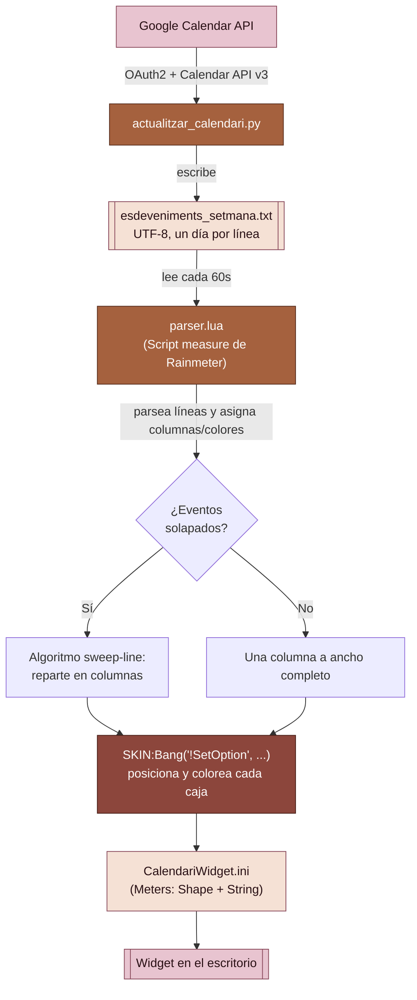
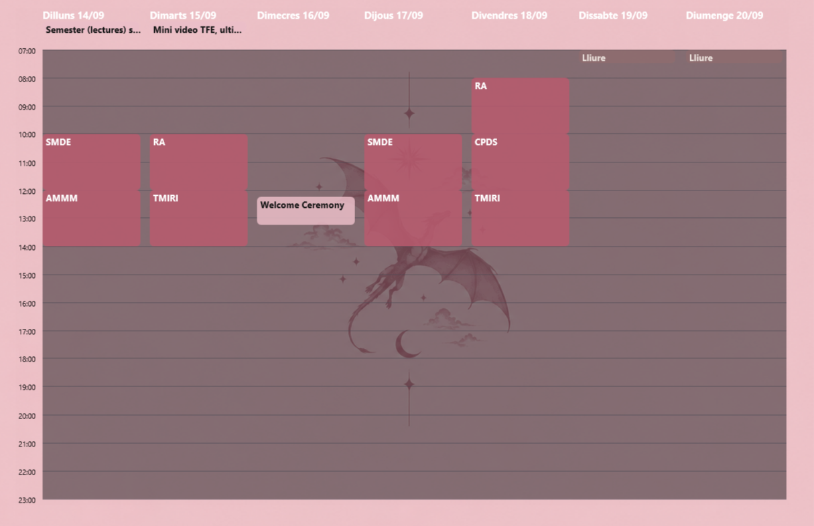

# Calendario — Rainmeter Widget

Un widget de escritorio para **Rainmeter** que muestra tu semana de Google Calendar en formato horizontal (estilo "vista semanal" de Google Calendar), con eventos repartidos automáticamente en columnas cuando se solapan, y una paleta de colores personalizada por calendario.

El proyecto tiene dos partes que trabajan juntas:

1. **`actualitzar_calendari.py`** — script en Python que se conecta a la Google Calendar API, descarga los eventos de la semana actual de todos tus calendarios, y los vuelca a un fichero de texto plano.
2. **Skin de Rainmeter** (`CalendariWidget.ini` + `parser.lua`) — lee ese fichero de texto y dibuja la rejilla semanal en el escritorio, calculando el layout y asignando colores según el calendario de origen de cada evento.

---

## Características

- Vista semanal horizontal (Lunes → Domingo), franja horaria de 07:00 a 23:00.
- Reparto automático de eventos solapados en columnas, igual que hace Google Calendar en su vista de semana/día (algoritmo *sweep-line*).
- Franja fija superior para eventos de "Todo el día".
- Colores por calendario, en una paleta de rosas y marrones, con transparencia; el color del texto (blanco/negro) se elige automáticamente según el contraste de cada fondo.
- Soporte para eventos que cruzan la medianoche (se parten en dos bloques, uno por día).
- Lectura robusta de codificación (UTF-8 y UTF-16 con BOM).
- Actualización automática cada 60 segundos por parte del skin (lectura del fichero de texto); la descarga de Google Calendar se ejecuta por separado (manual o programada).

---

## Arquitectura



### Flujo resumido

1. **Autenticación** — `actualitzar_calendari.py` usa OAuth2 (`credentials.json` → `token.json`) para autenticarse contra la Google Calendar API con permisos de solo lectura.
2. **Descarga** — obtiene la lista de calendarios del usuario, y para cada uno, los eventos de la semana actual (lunes a domingo).
3. **Clasificación por tag** — el nombre de cada calendario se compara contra `DICCIONARI_TAGS` para asignarle una etiqueta (`principal`, `horari`, `treball`, `gym`, `aniversaris`, `tasks`); si no coincide con ninguna palabra clave, se usa `principal` por defecto.
4. **Serialización** — escribe `esdeveniments_setmana.txt`, un fichero UTF-8 con un día por línea, formato `NombreDia|evento1 # evento2 # ...`.
5. **Lectura por Rainmeter** — `parser.lua` (medida `Script` dentro de `CalendariWidget.ini`) relee ese fichero en cada ciclo de `Update`.
6. **Layout** — por cada día, separa eventos de "todo el día" (franja fija arriba) de eventos con hora; a estos últimos les aplica el algoritmo de columnas para que los solapados se repartan en paralelo, igual que en Google Calendar.
7. **Render** — por cada evento, `parser.lua` llama a `SKIN:Bang('!SetOption', ...)` para mover, redimensionar, colorear y mostrar el par de *meters* `MeterEventBg_D_S` (fondo) y `MeterEvent_D_S` (texto) correspondientes a ese día (`D`) y slot (`S`).

---

## Estructura del repositorio

```
CalendariHoritzontal/
├── actualitzar_calendari.py     # Script Python: Google Calendar -> fichero de texto
├── credentials.json             # (NO subir a git) credenciales OAuth de Google Cloud
├── token.json                   # (NO subir a git, se genera solo) token de sesión
├── esdeveniments_setmana.txt    # (generado) datos de la semana, leídos por el widget
└── @Resources/
    ├── CalendariWidget.ini      # Definición del skin de Rainmeter (meters)
    └── parser.lua               # Motor de parseig + layout + colores
```

> **Importante:** `credentials.json` y `token.json` contienen datos sensibles de tu cuenta de Google. Añádelos a `.gitignore` y no los subas nunca al repositorio.

---

## Paleta de colores por calendario

Definida en `parser.lua`, tabla `Colors` / `TextColors`. Todos los fondos llevan un punto de transparencia (canal alfa ≈ 84%) para integrarse con el fondo del escritorio.

| Tag (`DICCIONARI_TAGS`) | Calendario de ejemplo | Color de fondo (RGBA) | Color de texto |
|---|---|---|---|
| `principal` | Calendario principal / personal | `235,190,200,215` — rosa pastel | Negro |
| `horari` | Horario / clases | `185,90,110,215` — rosa vino | Blanco |
| `treball` | Trabajo / beca | `165,95,75,215` — terracota | Blanco |
| `gym` | Gimnasio | `140,70,60,215` — marrón rojizo | Blanco |
| `aniversaris` | Cumpleaños | `90,55,50,215` — marrón chocolate | Blanco |
| `tasks` | Tareas | `245,225,205,215` — beige/crema | Negro |
| *(desconocido)* | Cualquier otro | `120,95,95,190` (`ColorDefaultBg`) | Blanco (`ColorDefaultText`) |
| *(día libre)* | Sin eventos | `150,110,110,140` (`ColorBuit`) | Blanco roto (`ColorBuitText`) |

La regla de contraste es simple: si la luminosidad del fondo es alta (color claro), el texto va en negro; si es baja (color oscuro), el texto va en blanco. Para añadir o cambiar un color, edita ambas tablas (`Colors` y `TextColors`) a la vez para mantener la legibilidad.

---

## Requisitos

- **Rainmeter** ≥ 4.3 (necesita soporte de *Script measures* con Lua y de *Shape meters*).
- **Python** 3.9+ para el script de sincronización.
- Dependencias de Python:
  ```bash
  pip install google-auth google-auth-oauthlib google-api-python-client
  ```
- Un proyecto en **Google Cloud Console** con la **Google Calendar API** habilitada y credenciales OAuth de tipo *Desktop App* descargadas como `credentials.json`.

---

## Instalación

1. **Clona o copia** este repositorio dentro de tu carpeta de skins de Rainmeter, normalmente:
   ```
   %USERPROFILE%\Documents\Rainmeter\Skins\CalendariHoritzontal\
   ```
2. **Configura Google Cloud:**
   - Crea un proyecto en [Google Cloud Console](https://console.cloud.google.com/).
   - Habilita la **Google Calendar API**.
   - Crea credenciales OAuth 2.0 de tipo "Aplicación de escritorio" y descarga el JSON como `credentials.json` en la raíz del proyecto.
3. **Instala las dependencias de Python** (ver sección de Requisitos).
4. **Ejecuta el script una vez** para autenticarte:
   ```bash
   python actualitzar_calendari.py
   ```
   Se abrirá el navegador para el login de Google; tras aceptar los permisos, se generará `token.json` (las siguientes ejecuciones ya no pedirán login, hasta que el token caduque).
5. **Verifica** que se ha creado `esdeveniments_setmana.txt` en la misma carpeta.
6. **Carga el skin en Rainmeter:** clic derecho en el icono de Rainmeter en la bandeja del sistema → *Manage* → busca `CalendariHoritzontal` → *Load*.
7. **(Opcional) Automatiza la sincronización** para que el widget se mantenga al día sin ejecutarlo a mano — por ejemplo con el Programador de tareas de Windows:
   ```
   Programador de tareas → Crear tarea básica
   Desencadenador: cada 30-60 minutos
   Acción: python.exe  C:\ruta\a\actualitzar_calendari.py
   ```

---

## Personalización

### Cambiar qué calendarios llevan qué tag

Edita `DICCIONARI_TAGS` en `actualitzar_calendari.py`. La clave es una palabra que se busca (en minúsculas) dentro del **nombre** del calendario en Google Calendar; el valor es el tag que se escribirá en el fichero de texto y que `parser.lua` usará para elegir el color:

```python
DICCIONARI_TAGS = {
    'principal':   'principal',
    'horari':      'horari',
    'treball':     'treball',
    'beca':        'treball',   # varios nombres de calendario -> mismo tag
    'gym':         'gym',
    'aniversaris': 'aniversaris',
    'tasks':       'tasks',
}
```

### Cambiar la paleta de colores

Edita las tablas `Colors` y `TextColors` en `parser.lua`. Después de guardar, **haz un Refresh del skin en Rainmeter** (los scripts Lua no se recargan solos, ver sección de Troubleshooting).

### Cambiar horario visible, tamaño de columnas, etc.

Las constantes al inicio de `parser.lua` controlan el layout:

| Variable | Significado |
|---|---|
| `NumDies` | Número de columnas/días mostrados (7) |
| `MaxAllDay` | Franjas reservadas para eventos "todo el día" por columna |
| `MaxTimed` | Franjas reservadas para eventos con hora por columna |
| `AmpladaColumna` / `EspaiColumnes` | Ancho de cada columna de día y espacio entre ellas |
| `TimeStart` / `TimeEnd` | Rango horario visible (en minutos desde medianoche) |
| `PxPerMin` | Píxeles verticales por minuto (controla la "altura" de la rejilla) |

---

## Ejemplo semana casual

---


